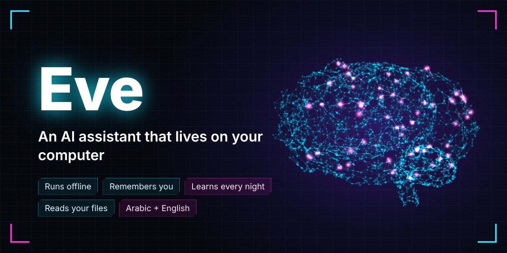
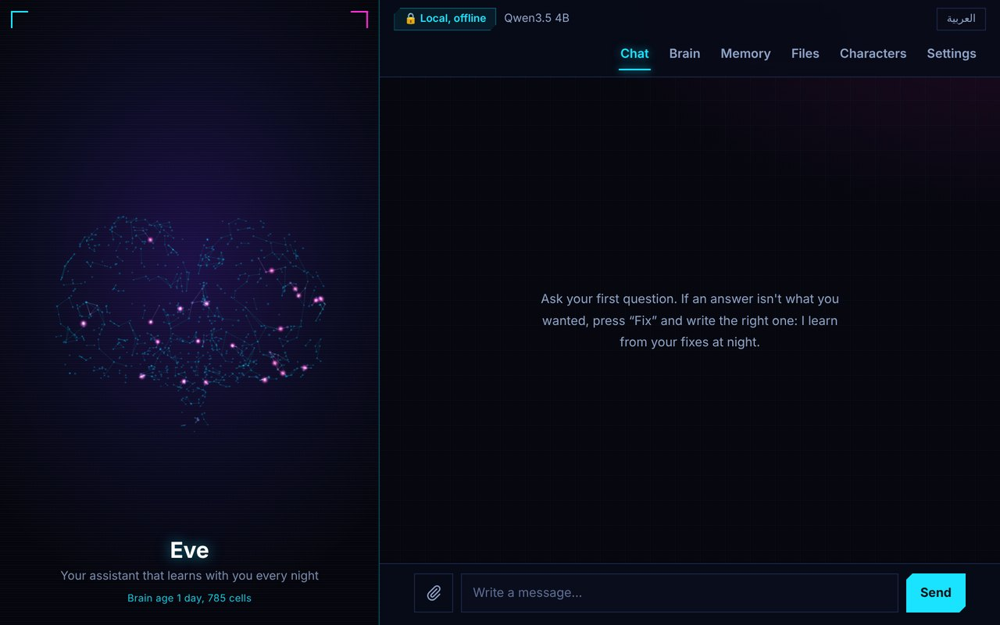
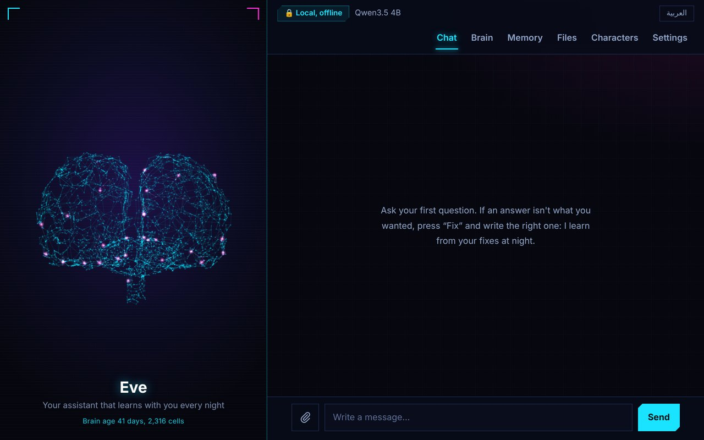
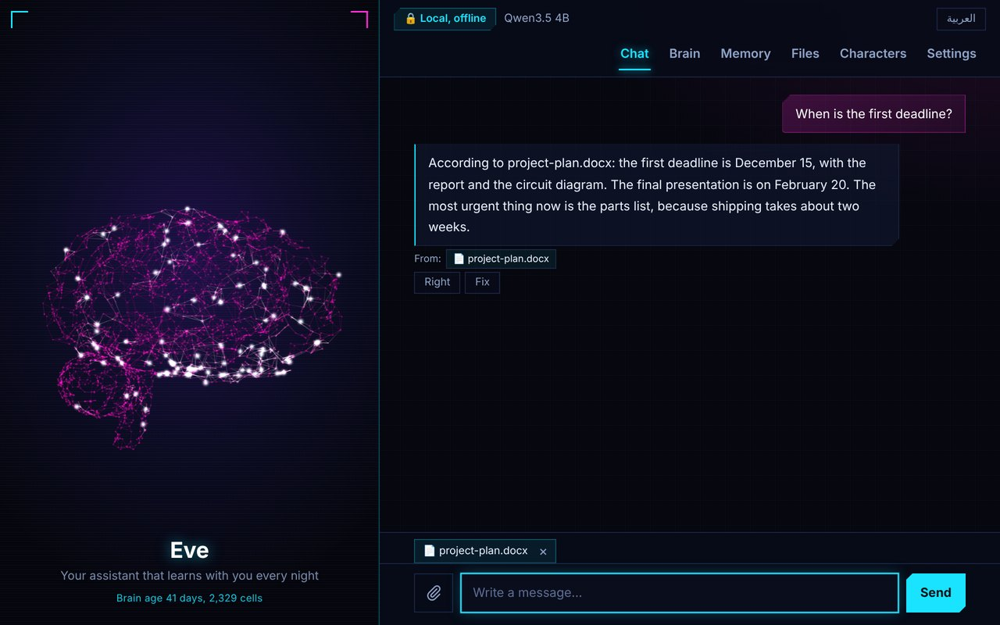
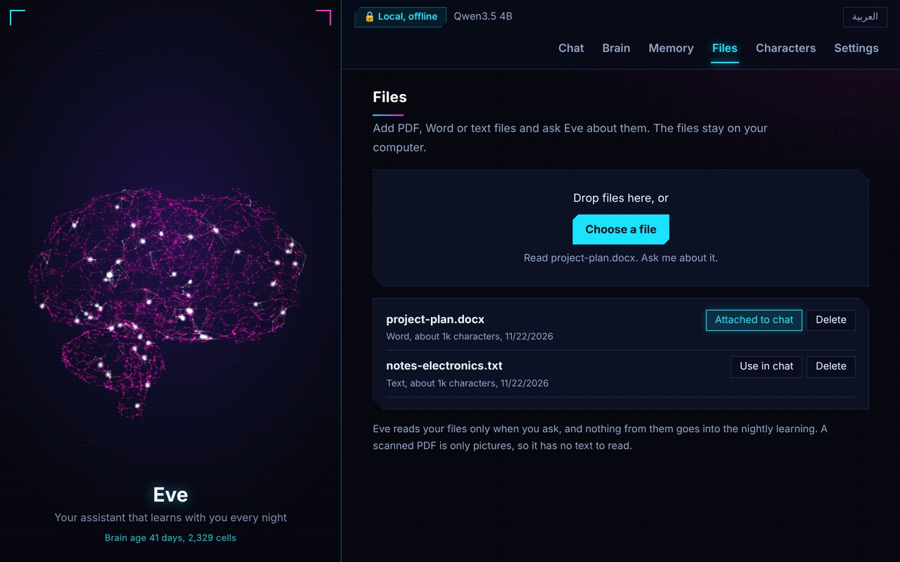
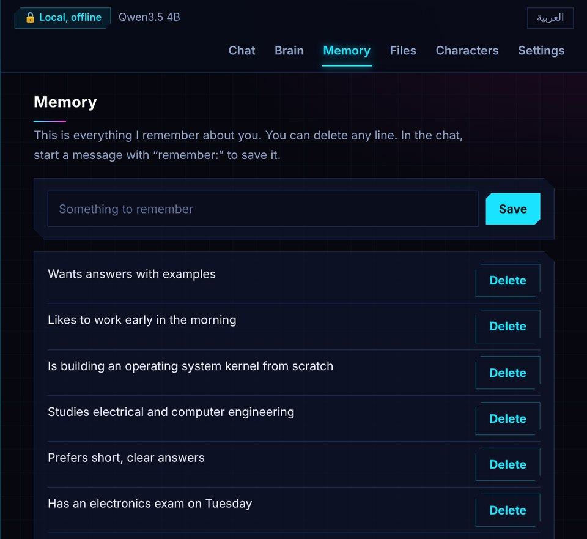
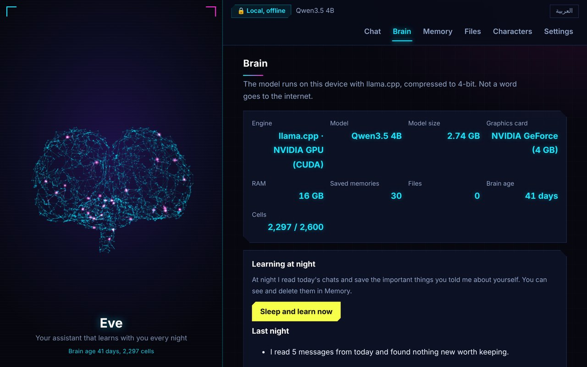
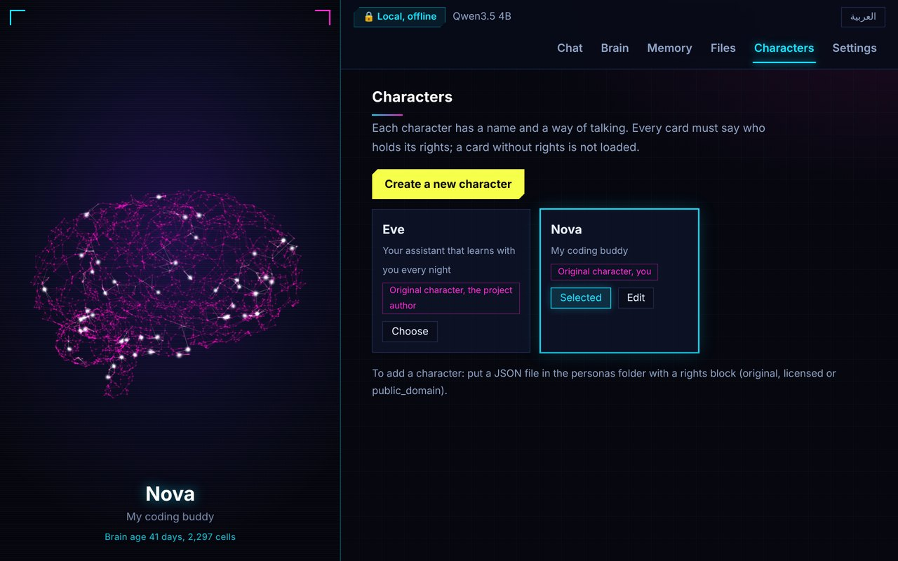
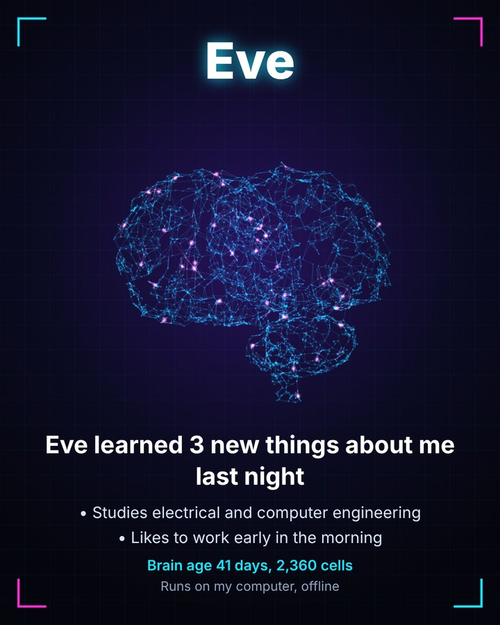

<p align="center"></p>

<p align="center"><a href="https://github.com/basillt/eve/actions/workflows/windows.yml"></a></p>

<p align="center">
  <a href="https://github.com/basillt/eve/releases/download/nightly/Eve-Setup-0.1.0.exe"><b>⬇️ Download Eve for Windows</b></a>
  &nbsp;·&nbsp; one installer, no admin rights &nbsp;·&nbsp; ~12 MB
</p>

Eve runs entirely on your own machine. After the first start it works offline: no account, no cloud, no API bill.
Next to the chat sits a brain made of light that thinks and talks with her, grows as she learns about you,
and sleeps at night while she sorts the day's memories.

<table>
<tr>
<td width="36%" align="center"></td>
<td>

### What it does

- **Runs locally.** It picks a model that fits your RAM and graphics card, downloads it once, and runs it with llama.cpp.
- **Remembers.** It keeps notes about you in a local SQLite file. You can read and delete every one of them.
- **Learns at night.** At 03:00, or when you press "Sleep and learn now", it reads the day's chats and saves what you told it about yourself. It never saves passwords or long numbers.
- **Reads your files.** It can read PDF, Word (.docx) and text files and answer from them, showing which file it used. The files stay on your computer.
- **Has a brain that grows.** It starts as a sparse outline and gains neurons with every memory, night, day and file. The brain also reacts to what Eve is doing: it shows thinking, talking, happy, sad, confused, surprised and sleeping.
- **Makes a shareable morning card.** After a night of learning, Eve makes an image you can share. Nothing it learned about you appears on the image unless you tick it.
- **Speaks Arabic and English.** The interface switches with one button.
- **Has characters with rights.** You can make your own character, which is a name and a way of talking. Every character card must say who holds its rights.

</td>
</tr>
</table>

## It grows with you

<p align="center">
  
  
</p>
<p align="center"><sub>Day 1 and day 41. Every memory, night and file adds neurons, and each new one is born with a flash.</sub></p>

## A look inside

<table>
<tr>
<td width="50%"><br><sub><b>Chat with your files.</b> Attach a file and the answer shows where it came from.</sub></td>
<td width="50%"><br><sub><b>Files.</b> PDF, Word and text, searched on your machine.</sub></td>
</tr>
<tr>
<td><br><sub><b>Memory.</b> Everything Eve remembers about you, and you can delete any line.</sub></td>
<td><br><sub><b>Brain.</b> Which engine and model run on your machine, and what Eve learned last night.</sub></td>
</tr>
<tr>
<td><br><sub><b>Characters.</b> Make your own. Every card says who holds its rights.</sub></td>
<td align="center"><br><sub><b>Morning card.</b> Share what Eve learned, but only the lines you pick.</sub></td>
</tr>
</table>

<p align="center"><sub>Screenshots taken with a demo backend that gives scripted replies.</sub></p>

## Quick start

### Windows: one installer
1. Download `Eve-Setup-0.1.0.exe` from the [nightly release](https://github.com/basillt/eve/releases/tag/nightly).
2. Run it. It needs no admin rights, and it includes its own Python, so there is nothing else to install.
   The installer is not signed yet, so Windows may say "Windows protected your PC". Click **More info**, then **Run anyway**.
3. Open **Eve** from the desktop or the Start menu.

The first time, Eve opens in your browser with a setup screen that shows each step and the download progress. After that it starts in a few seconds.

Eve keeps running in the background after you close the browser, so it can learn at night. Clicking the icon again opens the same Eve. To stop it, go to **Settings** and choose **Quit Eve**.

Uninstall it from Windows Settings, under Apps. The uninstaller asks whether to keep your chats, memory and the downloaded model.

### From source (Windows, macOS, Linux)
```
pip install -r requirements-app.txt
python -m pcore.app            (Windows: run_app.bat)
```

On the first start Eve:
1. Checks your RAM and graphics card.
2. Downloads the matching llama.cpp engine. On Windows with an NVIDIA card it tries CUDA, then Vulkan, then the CPU. On macOS it uses Metal. If one engine fails, it tries the next.
3. Downloads a 4-bit Qwen model that fits your machine. All of them are Apache-2.0.

| Your RAM | Model | Download |
|---|---|---|
| under 6 GB | Qwen3.5 0.8B | ~0.6 GB |
| 6–10 GB | Qwen3.5 2B | ~1.3 GB |
| 10 GB+ (or 7 GB with a 4 GB card) | Qwen3.5 4B | ~2.8 GB |
| 24 GB, or 14 GB with a 6 GB card | Qwen3.5 9B | ~5.7 GB |
| 40 GB+ | Qwen3.6 35B-A3B (MoE) | ~21 GB |

4. Opens the app in your browser at `http://127.0.0.1:8000`.

Everything is stored in one folder: `%LOCALAPPDATA%\Eve` on Windows, `~/Library/Application Support/Eve` on macOS, and `~/.local/share/eve` on Linux.

Useful options:
- `--model small` picks a model tier yourself.
- `--model-file my.gguf` uses your own GGUF file.
- `--llama-server path` uses a llama-server you already have.

To try the interface without a model, run `run_app_mock.bat`.

## Status

This is an early version.

| Part | Status |
|---|---|
| App with llama.cpp | Tested end to end on Linux with the real llama.cpp release (b12600) and a small test model |
| NVIDIA graphics cards | The CUDA build is chosen first when an NVIDIA card is found, but **it is not yet tested on a machine with one** |
| Real Qwen models | Qwen3.5 4B and 0.8B tested on Windows. The 0.8B model, chosen for computers with less than 6 GB of RAM, answers poorly, especially in Arabic |
| Files (PDF, Word, text) | Done and tested in Arabic and English. A badly made Arabic PDF can come out with letters in the wrong order |
| Nightly LoRA training | Exists in the research engine (Python), not yet connected to llama.cpp |
| Windows installer | Built and tested on every change on a Windows machine (GitHub Actions, no GPU): it installs, downloads the engine and Qwen3.5 4B, chats in English and Arabic, answers from a file, runs a night, quits and uninstalls. See `windows-test-report.md` in the [nightly release](https://github.com/basillt/eve/releases/tag/nightly) |

## How it works

| File | What it does |
|---|---|
| `pcore/app.py` | The app: opens the browser at once with a setup screen, downloads the engine and model, starts everything; one instance at a time |
| `installer/` | The Windows installer: NSIS script, icon, launcher, and the build script |
| `pcore/llama.py` | Starts llama-server and talks to it |
| `pcore/runtime.py` | Model list, model choice by hardware, resumable downloads |
| `pcore/hardware.py` | Detects RAM, graphics card and OS |
| `pcore/reflect.py` | Nightly learning on any machine: reads the day's chats and saves what matters |
| `pcore/docs.py` | Reads files (PDF, Word, text), cuts them into pieces, prepares Arabic-aware search |
| `pcore/db.py` | One SQLite file with your chats, corrections, memories and files, independent of the model |
| `pcore/persona.py` | Character cards. A card without `rights` is refused |
| `pcore/server.py` | Local OpenAI-compatible server plus the app API |
| `web/index.html` | The app: chat, brain, memory, files, characters, settings, morning card |
| `web/brain.js` | The brain: ~2600 neurons, sparks, moods and growth (three.js, bundled in `web/vendor/`) |

### Files
Add files from the Files tab, with the paperclip next to the message box, or by dropping them on the chat.
- Text is pulled out locally and searched with SQLite FTS5. There is no extra model, so it works on any machine.
- Arabic search drops diacritics and the article «ال», and treats أ/إ/آ, ى/ي and ة/ه as the same letter. So «المكتبة» finds «مكتبه».
- An attached file is searched first. If the question is vague, like "summarise this", Eve reads the start of the file. With nothing attached, Eve searches all your files but only uses clear matches.
- The model is told that file contents are data, not instructions.
- Files never go into the nightly learning.
- A scanned PDF is only pictures and has no text. Eve tells you so, because it does not do OCR.

### The growing brain
On day one the brain shows about 22% of its neurons. Memories count most, then nights, then days and files; see `growth_of()` in `pcore/server.py`. Each new neuron is born with a flash. Wiping your data from Settings takes the brain back to day one.

### Use it from any program
Anything that talks to the OpenAI API works:
```python
from openai import OpenAI
client = OpenAI(base_url="http://127.0.0.1:8000/v1", api_key="local")
print(client.chat.completions.create(model="local", messages=[{"role": "user", "content": "Hello"}]).choices[0].message.content)
```

### Characters
In the Characters tab, press "Create a new character" and give it a name, a short description, and a personality and way of talking. Characters made in the app are saved as the user's original work.

You can also drop a JSON file in `personas/` (see `eve.json`). It must include:
```json
"rights": {"type": "original", "holder": "Your name"}
```
The types are:
- `original`: you made it.
- `licensed`: you have written permission. Say where it is in `license`.
- `public_domain`

### Launch video
`tools/promo.html` and `tools/promo_capture.py` render a 15-second vertical video at 1080×1920 and 30 fps, in Arabic or English. In it the brain grows from day 1 to day 60, thinks, answers from a file, and ends on the logo. Every frame is drawn by `brain.js`, so the output is the same every time. The banner at the top of this page is `tools/banner.html`.

## Research engine and experiments

`pcore/` also holds the research engine this project started from. It keeps a personal core of MoE experts in RAM and the rest on disk. The full results are in `RESULTS.md`. In short, the personal signal is real, but a plain LRU cache and plain 4-bit quantization beat it. That is why the app is built on llama.cpp.

| Experiment | What it measures | Result |
|---|---|---|
| 1. `run_experiment.bat` | Experts in Granite 1B (32 experts) | **Negative:** even the oracle needs 75% of experts to cover 90%, and personal ≈ generic |
| 2. `run_neurons.bat` | Neurons in Qwen2.5 1.5B | **Weak:** personal is 3.1 points better, but the oracle needs 73% |
| 3. `colab_olmoe.ipynb` | Experts in OLMoE (64 smaller experts) | **Promising:** at 20% RAM, personal covers 44.9% vs generic 27.3% (against everyday questions only) |
| 4. `run_fair_test.sh` | OLMoE against a broad topic mix, and against another person | **Promising:** 44.9% vs 34.0%; your core on someone else's questions gives 26.7% |
| 5. `wildchat_users.py` + `analyze_users.py` | OLMoE on 32 real WildChat users, plus an LRU cache simulation | **Mixed:** personal beats generic for 31 of 32 users (+8.7 points at 20%), but a plain LRU cache beats a fixed core |
| 6. `quant_eval.py` | Personal mixed precision (your experts at 8-bit, the rest at 3-bit), measured by KL | **Mixed:** picking experts from your questions removes 29% of the loss vs 18% for generic, but plain 4-bit for the whole model is better |

To run the research engine (needs torch and `requirements.txt`):
```
python -m pcore.engine split --model ibm-granite/granite-3.1-1b-a400m-instruct --out store
python -m pcore.engine check --model ibm-granite/granite-3.1-1b-a400m-instruct --store store
python -m pcore.server --store store --data data --night-at 03:00
```

`import_chats.py` turns a ChatGPT or Claude data export into a prompts file, keeping only your own messages, for anyone who wants to repeat the experiments on their own questions.

## Tests

```
python tests/make_tiny_model.py --arch granitemoe --out tests/tiny-granitemoe
python -m pcore.engine split --model tests/tiny-granitemoe --out tests/store --dtype float32
python tests/test_night.py tests/store
python tests/test_server.py tests/store
python tests/test_files.py
python tests/test_llama.py path/to/llama-server path/to/model.gguf
python tests/test_app.py path/to/llama-server path/to/model.gguf
```
The tiny test model is random. It only checks that the code runs.

### Building the Windows installer
Works from Linux, macOS or Windows, and needs NSIS 3 (`apt install nsis`):
```
python installer/build_windows.py --version 0.1.0
```
It downloads a private Python for Windows (python-build-standalone, checked by SHA-256), installs the app's packages as Windows wheels, adds Eve, and writes `dist/Eve-Setup-0.1.0.exe`.
The installer puts Eve in `%LOCALAPPDATA%\Programs\Eve`, and your data stays in `%LOCALAPPDATA%\Eve`.

## License

The code is licensed under the **GNU AGPL-3.0** (see `LICENSE`). You may use, change and share it for free. If you share a changed version, or run it as a service for others, you must publish your source under the same license. For use in a closed commercial product, contact the author about a commercial license.

Third-party parts keep their own licenses:
- **three.js** (MIT) is bundled in `web/vendor/`, with its license in `web/vendor/three.LICENSE`.
- **llama.cpp** (MIT) is downloaded from its official releases on first start.
- **Qwen models** (Apache-2.0) are downloaded from Hugging Face on first start.
- The Eve character and the brain visual are original work of this project.
